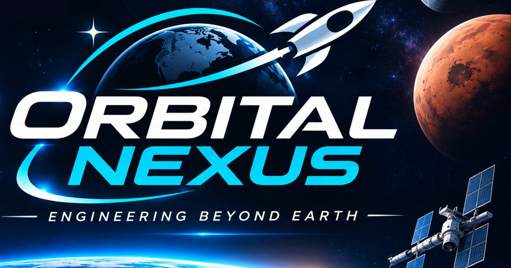

# ORBITAL NEXUS



**▶ Play / Jugar:** https://frankdux17.github.io/Proyecto_orbital-nexus/ ·
**One-click demo / Demo rápida:** https://frankdux17.github.io/Proyecto_orbital-nexus/#demo

Everything runs on the website: no install, no sign-in, Spanish and English, phone and PC.
Todo funciona en la web: sin instalar, sin registrarse, en español e inglés, en celular y PC.

**An interactive space mission design game.** Pick a destination, build the spacecraft,
fight for every watt and every gigabit, then operate the mission turn by turn while
space tries to break it.

NASA Space Apps Challenge — *Space Mission Design Game*.
Bilingual interface (Spanish / English), no build step, no dependencies.

> **Our goal / Nuestra meta.** Any student thinks like a NASA mission design team in a single
> game, and an engineer can check every number. · Que cualquier estudiante piense como un
> equipo de diseño de misiones de la NASA en una sola partida, y que un ingeniero pueda
> comprobar cada número.

**What we saw that is missing:** students don't lack information about missions; they can't
*see the consequences*. In class each topic is studied alone, but in a real mission one extra
instrument changes the mass, the power, the propellant, the rocket and the budget at once.
ORBITAL NEXUS makes that chain visible:

1. **Consequences before decisions** — every option shows its effect on cost, Δv, power and
   budget before you pick it.
2. **The whole design space at once** — the trade-space map evaluates every possible spacecraft
   for your mission and marks the Pareto front, the way NASA concurrent-engineering teams work.
3. **Beyond liftoff** — mission control staffing, GO/NO-GO, navigation from Earth and in-flight
   failures: people keep a mission alive.
4. **Low floor, high ceiling** — one-tap assistants for beginners, an engineering lab with real
   equations and CSV export for experts.
5. **Real physics, real missions** — Earth→Mars in 259 days for 5.6 km/s; Titan and Psyche
   modelled on Dragonfly and Psyche. Share any design by link and challenge a classmate.

---

## The challenge

> Designing a space mission requires careful consideration of competing demands,
> including mission objectives, spacecraft design, scientific instruments, launch
> vehicles, budgets, power, mass, communications and orbital constraints. For students
> who rarely have the chance to experience a complete mission from concept to operation,
> these trade-offs often remain abstract.

The word that matters in that brief is **abstract**. Everybody can recite that spacecraft
design is about trade-offs; almost nobody has felt one. ORBITAL NEXUS makes the trade-off
the gameplay: you cannot add an instrument without taking the mass from propellant, the
watts from the transmitter, or the money from the launch vehicle — and the game computes
what that costs you, using the same equations a real mission design team uses.

## What the game actually simulates

Six phases, and a decision in each one that can lose the mission:

| Phase | What you decide | What bites you |
|---|---|---|
| **1 · Mission** | Program class (budget + schedule) and destination | Each destination fixes the physics: Δv, distance, sunlight, radiation, eclipses |
| **2 · Platform** | Bus, solar arrays or RTG, battery, propulsion, propellant | The rocket equation, 1/r² solar power, and end-of-life array degradation |
| **3 · Science** | Which instruments to fly | Mass, watts and data volume all compete; objectives need *specific* instruments |
| **4 · Link** | Antenna, band, transmitter power, ground station, radiation shielding | A real link budget. A 0.6 m dish at Mars downlinks 4 kbps — your spectrometer makes 520 Gb/month |
| **5 · Launch** | Launch vehicle and development schedule | Energy class capability, fairing diameter, reliability, and the cost of rushing the test campaign |
| **6 · Operations** | Each turn: science vs. downlink vs. maintenance, and which instruments are powered | Solar flares, reaction wheel failures, memory overflow, oversubscribed DSN passes, budget cuts |

Then a **final report** scores science, engineering discipline, cost and survival, writes
a technical critique of your specific design, and names the real NASA mission yours most
resembles.

### Built to be played, not just studied

- **Three difficulty levels** (Cadet, Engineer, Flight director), as in NASA's telescope design game.
- **Your spacecraft, drawn live**: arrays, RTGs, dish, instruments, booms and lander legs change as you design.
- **Animated launch**: countdown, Max-Q, staging, fairing separation and spacecraft deploy — or the failure, if the odds say so.
- **Arrival mini game**: time the orbit insertion burn (or the parachute on Mars). Accuracy saves propellant or improves the landing odds.
- **Live mission view** during operations: the orbit, the science cone, data packets flowing to Earth and loss of line of sight behind the planet, all driven by your sliders.
- **Every phase is tagged** with its mission segment (launch, space, ground, user), JPL Concept Maturity Level and Mission Design Lab study type.
- **11 badges**, sound effects (mutable), keyboard shortcuts and **autosave**, so a mission can be paused on a short break and resumed later.

**The central lesson is deliberately brutal: only data you successfully downlink counts.**
A spectrometer that fills the memory and never transmits scores exactly zero.

### New: play as the mission team, then fly it in 3D

- **A mission team at every console.** Like JPL's Team X concurrent engineering room, each
  phase seats you next to a different specialist: the principal investigator, the systems
  engineer, the telecom engineer, the launch director, and an **astronaut CAPCOM** who talks
  you through operations. Each one reads your live design and tells you the one thing that
  matters most right now.
- **3D mission explorer.** Inspired by the Space Apps 2023 *Visualize a space mission in VR*
  challenge: drag to rotate, pinch to zoom, and scrub a timeline from the concept of
  operations to end of mission. It shows the Hohmann-type transfer to Mars, Venus, an
  asteroid or Jupiter, the GTO to geostationary orbit, the trans-lunar injection, the halo
  orbit around L2, and where every body is on each day.
- **CubeSat 101 lifecycle.** The explorer timeline walks the nine phases a CubeSat developer
  goes through: concept, design reviews, build and test, dispenser integration, launch,
  commissioning, arrival, operations and end of mission.
- **VR mode.** Side-by-side stereo with head tracking from the phone's orientation sensor:
  put a phone in a cardboard viewer and look around the solar system.
- **Illustrated interface.** Every destination, instrument, bus, engine and launcher has its
  own artwork, drawn as inline SVG so it follows the light and dark themes.

### New: the ground segment — mission control, launch day and navigation

- **Staff mission control.** Choose who sits on console: FLIGHT and CAPCOM, then FIDO
  navigators (0–3), GNC, EECOM, INCO and science operations, on one shift or 24/7. Every seat
  costs money each turn and changes the game: navigators make trajectory corrections more
  precise, EECOM softens power damage, INCO and SCI raise data and science, and a staffed
  console unlocks a cheaper **team answer** when its subsystem fails.
- **New failures.** Space debris conjunctions, loss of signal, a human error in an uplinked
  command sequence, a battery cell short, a geomagnetic storm that drags a low orbit down,
  and a blinded star tracker.
- **Flight readiness review and GO / NO-GO poll.** Before liftoff every item is checked, each
  with a "how to improve it" fix, then the day's weather (pad winds, upper-level winds, the
  lightning rule, the range exclusion zone, space weather) and a roll call of every console.
  Scrub 24 h and pay the standing-army cost, or launch into a NO-GO and accept the risk.
- **Fly the ascent yourself.** A point-mass ascent over a round, rotating Earth: gravity turn,
  Max-Q (above 45 kPa the vehicle breaks up), staging, fairing jettison above 100 km, and
  orbit judged from the perigee of the live state vector. A risk-free launch simulator is
  available from the start screen.
- **Navigation from Earth.** During the cruise, track the spacecraft with the Deep Space
  Network (Doppler, ranging, ΔDOR) and fly three trajectory correction manoeuvres on the
  B-plane. Early corrections are cheap and late ones are expensive. The final miss widens or
  narrows the arrival burn window and changes the landing odds.
- **Recommendations.** The bus, propulsion and launcher that fit your design are flagged as
  recommended, and each phase has a "how to choose" guide.

### New: easy choices and an engineering lab

- **See before you choose.** Every bus, engine, band, station, shield and rocket card shows
  what it would do to the mission before you click it: the cost change and a ✓ / ✕ for Δv,
  power, payload and budget. Rocket cards show a bar of how much of their capability you use.
- **Automatic sizing.** Arrays, battery and propellant size themselves with the same rules
  an engineer applies by hand (rocket equation, end-of-life power, eclipse battery). Move a
  slider to take manual control; flip the switch to hand it back.
- **One-tap assistants.** Ready missions for a first flight (Moon, Mars, Europa), three design
  packages (Lean / Balanced / Robust) with their margins side by side, an instrument picker
  that keeps a budget reserve, a link solver that tries every antenna × amplifier × band ×
  station, and a rocket picker.
- **Engineering lab** for scientists, engineers and astronauts who want their own numbers:
  rocket equation with engine comparison, Hohmann transfers with phase angle, launch-window
  period and departure C3, orbit geometry (period, eclipse, ground track), a decibel link
  budget table, solar power and battery over the mission, and a **trade-space map** that
  evaluates every bus × propulsion × rocket × power source for your mission, plots cost
  against chance of success, marks the Pareto front, exports CSV and applies any design.
- **Share and play.** “Share my design” creates a link with the whole spacecraft for a classmate
  to open and improve; a new mini game flies a Dragonfly-style drone over Titan's dunes
  (1.35 m/s² gravity, air four times denser than Earth's, a methane lake and an RTG-charged
  battery), and its samples add science to a Titan mission.
- **Friendlier.** A mission status ring lists what is missing in plain words and fixes it
  on request (“Fix it for me”); technical words (Δv, Isp, C3, RTG, krad, DSN…) explain
  themselves when tapped; a three-step welcome tour on the first game; and a celebration
  the first time each phase closes with every margin green.

## Eleven destinations

Sun-synchronous LEO · geostationary orbit · low lunar orbit · Sun-Earth L2 ·
Mars orbit · Mars surface (with entry, descent and landing) · Venus orbit ·
near-Earth asteroid rendezvous · the Jupiter / Europa system · **new:** the metal asteroid
Psyche (electric propulsion at 3 AU) · **new:** a Dragonfly-style rotorcraft lander on Titan
(RTG power at 9.5 AU, landing through a thick atmosphere).

They are not reskins of each other. At Europa you get 1/30th of the sunlight, a six-year
cruise and 2800 krad of radiation — fly it without an electronics vault and you will lose
every instrument before the mission ends (measured: 46 of 57 simulated missions). In LEO
the link is effectively free and the binding constraint is collection time and the eclipse
every 96 minutes.

## Running it

It is static HTML, CSS and JavaScript. No npm, no bundler, no server required.

```bash
git clone <this-repo>
cd orbital-nexus
# then just open index.html in a browser
```

With Laragon / XAMPP, drop the folder in your web root and visit `http://localhost/orbital-nexus`.
It also deploys as-is to GitHub Pages (Settings → Pages → deploy from branch root).

## Project layout

```
index.html              markup shell
assets/css/style.css    design system, light and dark
assets/js/i18n.js       ES / EN string table
assets/js/data.js       mission catalogue: destinations, buses, instruments, launchers, events
assets/js/engine.js     the engineering model — rocket equation, power, link budget, scoring
assets/js/fx.js         sound, badges, difficulty levels, autosave, keyboard shortcuts
assets/js/viz.js        live spacecraft preview, mission view, launch sequence, arrival mini game
assets/js/art.js        illustrated destinations, icon set and mission team avatars (inline SVG)
assets/js/coach.js      the mission team: live, phase-specific advice from each console
assets/js/explorer.js   3D mission explorer, CubeSat 101 timeline and VR stereo mode
assets/js/ascent.js     piloted ascent: physics, guidance, controls and the training simulator
assets/js/mission.js    mission control staffing, readiness review, GO/NO-GO, cruise navigation
assets/js/design.js     easy choices: impact preview, automatic sizing, presets and assistants
assets/js/lab.js        engineering lab: calculators, charts and the trade-space map
assets/js/help.js       status ring, glossary, welcome tour, celebrations, share links, vision panel
assets/js/titan.js      Titan rotorcraft flight mini game
assets/js/space-bg.js   interactive space background (parallax stars, nebulae, constellation, comets)
assets/img/             project logo, poster, favicon and social preview
assets/js/app.js        state machine, interface, operations simulator
docs/MODEL.md           every equation and where its numbers come from
```

`engine.js` is deliberately separate from the interface and has no DOM dependency, so the
model can be tested, audited, or reused on its own.

## Is the physics real?

Simplified, but not invented. The rocket equation, the inverse-square solar power budget
and the telecom link budget are computed properly; masses, costs, launch vehicle
capabilities and radiation environments are anchored on public NASA and launch-provider
figures. [`docs/MODEL.md`](docs/MODEL.md) lists every equation, every constant, and the
places where the model knowingly simplifies — including the ones that would make a real
mission engineer wince.

A worked example of the model's honesty: a 2.5 m Ka-band antenna with a 100 W transmitter
to a DSN 34 m station, at 1.9 AU, computes to about 5 Mbps. Mars Reconnaissance Orbiter's
real Ka-band link sits in the same range for comparable hardware. Shrink that antenna to
0.6 m on X-band with a 20 W transmitter and the model returns 4.2 kbps — a factor of 1200
worse, which is exactly the cliff that makes antenna sizing a real decision rather than a
menu choice.

## Credits

Built for the NASA Space Apps Challenge by **Proyecto ORBITAL NEXUS**.

Reference data drawn from public NASA sources — planetary fact sheets, the JPL Deep Space
Network Telecommunications Link Design Handbook (810-005), NASA radioisotope power system
specifications, Launch Services Program vehicle performance data, and the public mission
pages for MRO, LRO, InSight, OSIRIS-REx, Magellan, JWST, GOES and Europa Clipper.

Released under the MIT licence.

---
---

# ORBITAL NEXUS (español)

**Un juego interactivo de diseño de misiones espaciales.** Elige un destino, construye la
nave, pelea por cada vatio y cada gigabit, y después opera la misión turno a turno
mientras el espacio intenta romperla.

NASA Space Apps Challenge — *Juego de diseño de misiones espaciales*.
Interfaz bilingüe (español / inglés), sin proceso de compilación, sin dependencias.

## El desafío

> El diseño de una misión espacial requiere una cuidadosa consideración de las demandas
> contrapuestas... Para los estudiantes que rara vez tienen la oportunidad de experimentar
> con una misión completa, desde el concepto hasta la operación, estas compensaciones
> suelen permanecer **abstractas**.

Esa es la palabra clave. Cualquiera puede recitar que diseñar una nave es cuestión de
compromisos; casi nadie los ha sentido. ORBITAL NEXUS convierte el compromiso en la
mecánica del juego: no puedes agregar un instrumento sin quitarle masa al propelente,
vatios al transmisor o dinero al cohete — y el juego calcula exactamente lo que eso te
cuesta, con las mismas ecuaciones que usa un equipo real de diseño de misiones.

## Qué simula el juego

Seis fases, y en cada una una decisión capaz de perder la misión:

| Fase | Qué decides | Qué te castiga |
|---|---|---|
| **1 · Misión** | Clase de programa (presupuesto + cronograma) y destino | Cada destino fija la física: Δv, distancia, luz solar, radiación, eclipses |
| **2 · Plataforma** | Bus, paneles solares o RTG, batería, propulsión, propelente | La ecuación del cohete, la potencia solar por 1/r² y la degradación de los paneles |
| **3 · Ciencia** | Qué instrumentos llevas | Masa, vatios y volumen de datos compiten entre sí; cada objetivo exige instrumentos *específicos* |
| **4 · Enlace** | Antena, banda, potencia de transmisión, estación terrena, blindaje | Un presupuesto de enlace real. Una antena de 0,6 m en Marte baja 4 kbps, y tu espectrómetro genera 520 Gb al mes |
| **5 · Lanzamiento** | Vehículo de lanzamiento y tiempo de desarrollo | Capacidad por clase de energía, diámetro del cofre, fiabilidad, y el precio de acortar las pruebas |
| **6 · Operaciones** | Cada turno: ciencia vs. transmisión vs. mantenimiento, y qué instrumentos enciendes | Fulguraciones solares, fallas de ruedas de reacción, memoria saturada, DSN sobresuscrita, recortes de presupuesto |

Después, un **informe final** puntúa ciencia, disciplina de ingeniería, costo y
supervivencia, escribe una crítica técnica de tu diseño concreto, y nombra la misión real
de la NASA a la que más se parece.

**La lección central es deliberadamente brutal: solo cuentan los datos que logras bajar a
Tierra.** Un espectrómetro que llena la memoria y nunca transmite vale exactamente cero.

### Nuevo: juega como el equipo de misión y vuela tu misión en 3D

- **Un equipo de misión en cada consola.** Como en la sala de ingeniería concurrente Team X
  del JPL, cada fase te sienta junto a un especialista distinto: la investigadora principal,
  el ingeniero de sistemas, la ingeniera de telecomunicaciones, la directora de lanzamiento
  y un **astronauta CAPCOM** que te guía durante las operaciones. Cada uno lee tu diseño en
  vivo y te dice lo más importante en ese momento.
- **Explorador 3D de la misión.** Inspirado en el reto *Visualiza una misión espacial con
  realidad virtual* de Space Apps 2023: gira con el dedo o el ratón, acerca con la rueda o
  pellizcando y recorre una línea de tiempo desde el concepto hasta el fin de la misión.
- **Ciclo de vida CubeSat 101.** La línea de tiempo recorre las nueve fases que vive un
  desarrollador de CubeSat: concepto, revisiones de diseño, fabricación y pruebas,
  integración en el dispensador, lanzamiento, puesta en servicio, llegada, operaciones y
  fin de misión.
- **Modo RV.** Estéreo lado a lado con seguimiento de la cabeza mediante el sensor de
  orientación del celular: pon el teléfono en un visor tipo Cardboard y mira a tu alrededor.
- **Interfaz ilustrada.** Cada destino, instrumento, bus, motor y cohete tiene su propia
  ilustración en SVG, que se adapta al tema claro y oscuro.

### Nuevo: el segmento terrestre — centro de control, día del lanzamiento y navegación

- **Arma tu centro de control.** Eliges quién se sienta en cada consola: FLIGHT y CAPCOM,
  navegantes FIDO (de 0 a 3), GNC, EECOM, INCO y operaciones científicas, en un turno o
  24/7. Cada puesto cuesta dinero por turno y cambia el juego: los navegantes hacen más
  precisas las correcciones, EECOM reduce el daño de potencia, INCO y SCI suben los datos y
  la ciencia, y cuando una consola tiene a alguien, aparece una **respuesta del equipo**
  más barata si su subsistema falla.
- **Nuevas fallas.** Alerta de choque con basura espacial, pérdida de señal, error humano en
  los comandos enviados, cortocircuito de una celda de batería, tormenta geomagnética que
  baja la órbita y sensor estelar cegado.
- **Revisión de vuelo y votación GO / NO-GO.** Antes del despegue se revisa cada punto, con
  una sugerencia de «cómo mejorarlo». Después se revisa el clima del día (viento, vientos en
  altura, regla de rayos, zona de exclusión, clima espacial) y cada consola vota. Puedes
  posponer 24 h pagando el costo de espera, o lanzar con un NO-GO y asumir el riesgo.
- **Pilota el despegue.** Física de ascenso sobre una Tierra redonda que gira: giro
  gravitatorio, Max-Q (sobre 45 kPa el cohete se rompe), separación de etapas, la cofia por
  encima de 100 km, y la órbita se juzga por el perigeo. Hay un simulador de práctica sin
  riesgo desde la portada.
- **Navegación desde la Tierra.** Durante el crucero rastreas la nave con la Red de Espacio
  Profundo (Doppler, distancia, ΔDOR) y haces tres correcciones de trayectoria en el plano B.
  Corregir temprano es barato y tarde es caro. El error final ensancha o estrecha la ventana
  del encendido de llegada y cambia la probabilidad de aterrizar.
- **Recomendaciones.** Se marcan el bus, la propulsión y el cohete que mejor encajan con tu
  diseño, y cada fase trae una guía de «cómo elegir».

### Nuevo: elegir fácil y un laboratorio de ingeniería

- **Mira antes de elegir.** Cada tarjeta de bus, motor, banda, estación, blindaje y cohete
  muestra qué le haría a la misión antes de tocarla: el cambio de costo y un ✓ / ✕ para Δv,
  energía, carga y presupuesto. Los cohetes muestran una barra de cuánto de su capacidad usas.
- **Dimensionado automático.** Paneles, batería y propelente se ajustan solos con las mismas
  reglas que usa un ingeniero (ecuación del cohete, potencia al final de la vida, batería
  para el eclipse). Mueve un control para tomar el mando manual.
- **Asistentes de un toque.** Misiones listas para empezar (Luna, Marte, Europa), tres
  paquetes de diseño (Económica / Equilibrada / Robusta) con sus márgenes lado a lado, un
  selector de instrumentos que guarda reserva de presupuesto, un solucionador de enlace que
  prueba todas las antenas × amplificadores × bandas × estaciones, y un selector de cohete.
- **Laboratorio de ingeniería** para científicos, ingenieros y astronautas que quieren sus
  propios cálculos: ecuación del cohete con comparación de motores, transferencias de
  Hohmann con ángulo de fase, período de ventanas y C3 de salida, geometría orbital
  (período, eclipse, traza), presupuesto de enlace en decibelios, energía solar y batería a
  lo largo de la misión, y un **mapa de compensaciones** que evalúa todas las naves posibles
  para tu misión, grafica costo contra probabilidad de éxito, marca la frontera de Pareto,
  exporta CSV y aplica cualquier diseño.
- **Comparte y juega.** «Compartir mi diseño» crea un enlace con la nave completa para que un
  compañero la abra y la mejore; un minijuego nuevo vuela un dron tipo Dragonfly sobre las
  dunas de Titán (gravedad de 1,35 m/s², aire cuatro veces más denso, un lago de metano y una
  batería que recarga el RTG), y sus muestras suman ciencia a la misión a Titán.
- **Más amigable.** Un anillo de estado de la misión dice qué falta en palabras simples y
  lo arregla si se lo pides («Arréglalo por mí»); las palabras técnicas (Δv, Isp, C3, RTG,
  krad, DSN…) se explican al tocarlas; una guía de bienvenida de tres pasos y una
  celebración la primera vez que cada fase cierra con todos los márgenes en verde.

## Once destinos

Órbita baja heliosíncrona · órbita geoestacionaria · órbita lunar baja · punto Sol-Tierra L2 ·
órbita de Marte · superficie de Marte (con entrada, descenso y aterrizaje) · órbita de Venus ·
rendezvous con asteroide cercano · sistema de Júpiter / Europa · **nuevo:** el asteroide
metálico Psyche (propulsión eléctrica a 3 UA) · **nuevo:** un aterrizador volador tipo
Dragonfly en Titán (energía RTG a 9,5 UA y aterrizaje en una atmósfera densa).

No son el mismo destino repintado. En Europa recibes 1/30 de la luz solar, un crucero de
seis años y 2800 krad de radiación: vuela sin bóveda de electrónica y perderás todos los
instrumentos antes de terminar (medido: 46 de 57 misiones simuladas). En órbita baja el
enlace es prácticamente gratis y lo que limita es el tiempo de observación y el eclipse
cada 96 minutos.

## Cómo ejecutarlo

Es HTML, CSS y JavaScript estáticos. Sin npm, sin empaquetador, sin servidor.

```bash
git clone <este-repo>
cd orbital-nexus
# y abre index.html en el navegador
```

Con Laragon o XAMPP, coloca la carpeta en tu raíz web y visita `http://localhost/orbital-nexus`.
También se publica tal cual en GitHub Pages (Settings → Pages → desde la raíz de la rama).

## ¿La física es real?

Simplificada, pero no inventada. La ecuación del cohete, el presupuesto de potencia solar
por el inverso del cuadrado y el presupuesto de enlace se calculan de verdad; masas,
costos, capacidades de lanzadores y entornos de radiación están anclados en datos públicos
de la NASA y de los proveedores de lanzamiento. [`docs/MODEL.md`](docs/MODEL.md) documenta
cada ecuación, cada constante y cada simplificación consciente del modelo.

## Créditos

Desarrollado para el NASA Space Apps Challenge por **Proyecto ORBITAL NEXUS**.
Licencia MIT.
